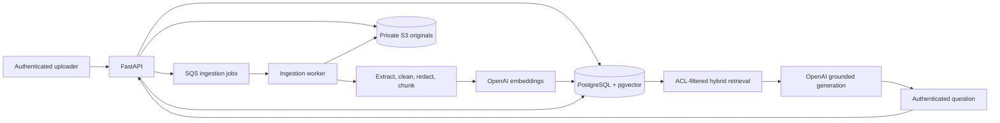

# HarborDesk RAG application: initial build plan

This project uses the supplied fictional Nimbu Mart corpus as its development
corpus. The original course download remains untouched. Local working copies of
all raw files, `_metadata.json`, and the 33-question evaluation set live under
`data/course_corpus/`.

## Product boundary

First release: a private support knowledge API for one organization. Document
access groups follow the sample metadata (`public`, `employees`, `hr`). The
database schema will include `tenant_id` from its first migration so that
organizations can be isolated if the product later needs multiple tenants.
Every query must derive the caller's identity and groups from verified auth;
request headers supplied directly by an untrusted client do not grant access.

The source folder deliberately includes an HR-only salary document, sample
tickets marked as containing PII, archived policy versions, and untrusted
community content. These are test cases for ACL enforcement, redaction,
versioning, and prompt-injection resistance. All source documents are fictional
course data, but only public documents should be sent to model APIs during early
development. Do not upload the full corpus to AWS until permission filtering and
secret handling are working and the request boundary is clear.

## Target layout

```text
app/
  api/                 HTTP routes, request validation, auth dependency
  domain/              Document, chunk, job, and answer types
  ingestion/           File validation, extraction, cleaning, chunking
  retrieval/            ACL-filtered hybrid search and optional reranking
  generation/           Bounded context, grounded answer, checked citations
  providers/            OpenAI embedding and generation adapters
  storage/              PostgreSQL repositories and private S3 objects
  workers/              Idempotent ingestion job handlers
migrations/             Versioned PostgreSQL schema
tests/                  Unit and local integration tests
evals/                  Versioned labeled queries and reports
data/course_corpus/      Supplied fictional source documents and golden set
infra/                   AWS deployment definitions, added after local design
docs/                    Architecture decisions and runbooks
```

The API and worker are separate processes. A durable job state in PostgreSQL is
the source of truth; queue publication and database state must not silently
diverge. A transactional outbox or reconciliation process closes that failure
case before the service is called reliable.

## Storage and request flow



S3 stores original files. PostgreSQL stores document identity and version,
metadata, processing state, chunk text, access groups, model fingerprint,
embeddings, and PostgreSQL full-text search representation. SQS carries jobs,
not document state. Embeddings never cross model versions in a query. A
re-embedding migration builds a replacement index and changes the active model
only after evaluation passes.

For local development, Docker Compose will run PostgreSQL with pgvector and
LocalStack (S3/SQS API emulation). OpenAI remains an external paid dependency.
No AWS resource is assumed to be covered by a Free account plan. The target AWS
design is S3 + SQS + PostgreSQL/pgvector + a FastAPI service and a separate
worker. The exact compute/database combination depends on eligible services,
region, account limits, and current costs; confirm those before provisioning.

## Build order and release gates

1. **Corpus inventory.** Read metadata, preserve source identity, enumerate
   formats, group access, flags, and golden-set coverage. Reject ambiguous or
   unknown metadata rather than silently treating a document as public.
2. **Ingestion contract.** Accept validated files, store immutable originals,
   record a content hash and version, and enqueue an idempotent job. Bound file
   size, formats, extraction time, and page count.
3. **Extraction and indexing.** Route Markdown, HTML, CSV, text, and digital PDF
   through format-specific extractors; send scanned pages to OCR. Preserve page,
   row, or heading provenance. Redact marked PII and keep untrusted sources
   labeled. ACL-filter before model context is built.
4. **Query service.** Verify caller identity, apply tenant and group filters in
   the database search itself, use hybrid retrieval, bound evidence by tokens,
   and return abstention with source references when evidence is insufficient.
5. **Evaluation and safety.** Run the supplied golden set, add separate answer
   support checks, test public/employee/HR leakage and archived versions, and
   test document prompt injection. A citation ID existing in the index is not
   proof that the cited passage supports the answer.
6. **Local deployment.** Run the API, worker, Postgres, SQS emulator, and object
   store with health checks and migration commands in Docker Compose.
7. **AWS staging.** Review region, Free Plan eligibility, cost alert, IAM roles,
   private S3 access, network exposure, encryption, retention, backups, and
   logging before applying infrastructure. Deploy staging first and exercise
   upload, retry, deletion, and authorization flows.

The supplied app code is a course reference for patterns, not a deployment
artifact. In particular, caller-provided group headers and filename-derived
storage keys are not acceptable production authorization or object-key designs.
